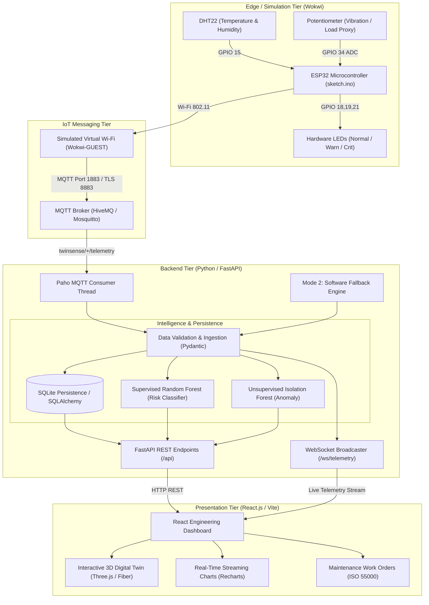

# TwinSense — Overall System Architecture

## 1. High-Level Architecture Diagram

---

## 2. Dual Operating Modes

### Mode 1: Connected IoT Simulation
1. Sensor readings originate from the **ESP32** running in Wokwi.
2. The firmware samples the DHT22 and potentiometer proxy every 2000ms.
3. Telemetry is serialized into structured JSON and published to `twinsense/MOTOR-001/telemetry`.
4. The Python backend receives the MQTT packet, runs ML inference, stores the reading in SQLite, and broadcasts the digital twin state over `/ws/telemetry`.

### Mode 2: Software Fallback Simulation
1. Active when Wokwi is disconnected or when local testing without internet access is desired.
2. The Python `fallback_simulator` generates authentic physical readings with mathematical micro-jitter and realistic slip curves.
3. Data is explicitly tagged with `source: "software_fallback"`. It is never misrepresented as physical hardware telemetry.
